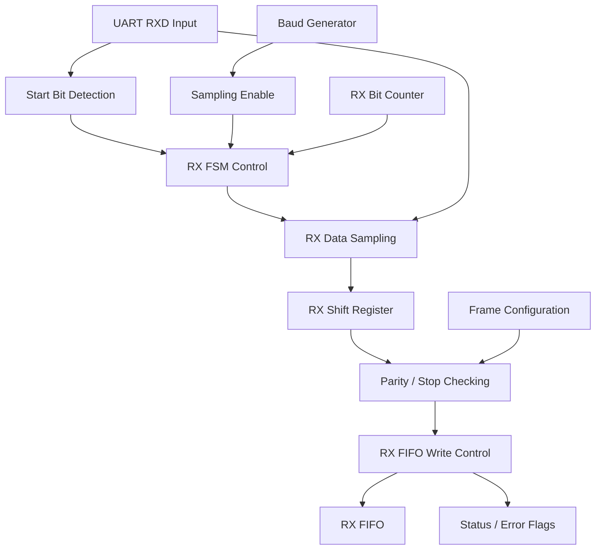
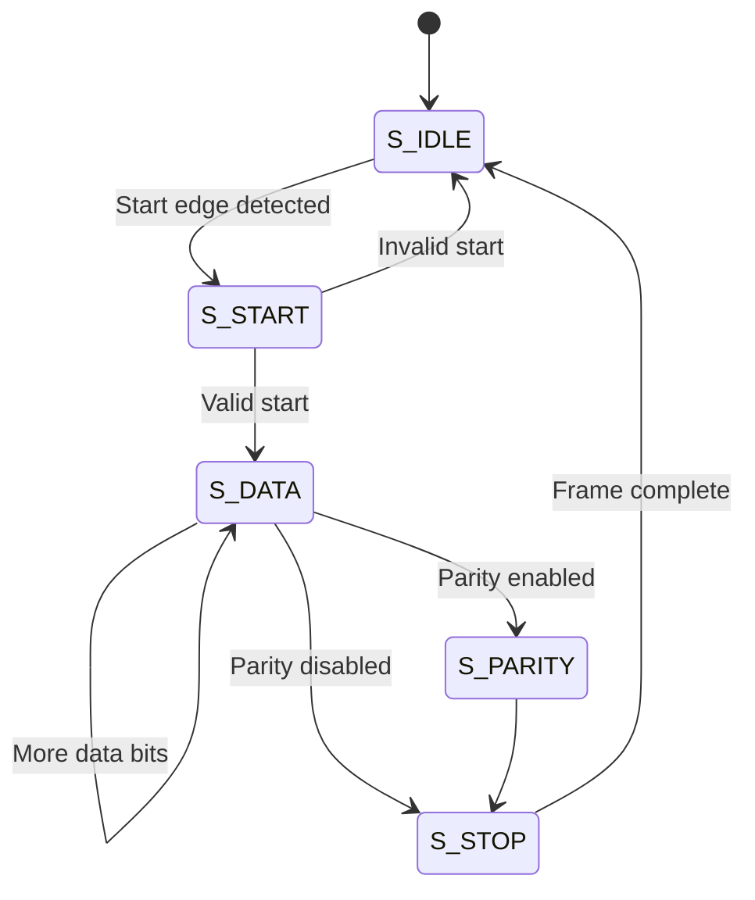

# UART Receiver Core Specification

**Version:** 0.1 (Architecture Draft)  
**Status:** Proposed – Pending RTL Validation  
**Block:** UART RX  
**Related Block:** UART TX / UART Baud Generator / RX FIFO

---

## 1. Overview

The UART RX block is responsible for receiving serial data from the external UART interface, reconstructing the transmitted frame, checking frame integrity, and storing the received data into the RX FIFO.

The receiver operates based on the configured baud rate and frame format.

The RX block shall support:

- Start bit detection
- Data bit sampling
- Configurable data length
- Optional parity checking
- Configurable stop bit length
- RX FIFO write control
- Receive error detection
- RX status reporting
- UART enable control

The RX block shall synchronize its internal receiving operation to the incoming serial data stream and use the baud generator timing to sample the received bits.

---

## 2. Functional Block Architecture

The RX block is divided into eight functional blocks.

| Block | Name | Description |
|---|---|---|
| 1 | Baud Enable / Sampling Control | Generates or receives sampling enable timing |
| 2 | RX Bit Counter | Tracks the number of received data bits |
| 3 | RX FSM Control | Controls the receive sequence |
| 4 | Start Bit Detection | Detects the incoming start bit |
| 5 | RX Data Sampling / Shift Register | Samples and assembles incoming data |
| 6 | Parity / Stop Configuration and Checking | Configures and validates frame information |
| 7 | RX FIFO Write Control | Writes received data into FIFO |
| 8 | RX Status / Error Flags | Reports RX status and error conditions |

---

## 3. Block Diagram



---

## 4. Parameters

| Parameter | Description |
|---|---|
| `DATA_BITS` | Number of data bits in one UART frame |
| `FIFO_DEPTH` | RX FIFO storage capacity, if parameterized |
| `BAUD_DIV` | Baud rate divisor, if configured internally |

Parameter values and implementation method shall be confirmed from the RTL.

---

## 5. Interface

### 5.1 Input Ports

| Signal | Direction | Width | Description |
|---|---|---|---|
| `I_CLK` | Input | 1 | UART system clock |
| `I_RST_N` | Input | 1 | Active-low asynchronous reset |
| `I_UART_EN` | Input | 1 | UART receiver enable |
| `I_BRG_DIV` | Input | 16 | Baud divisor value (from `REG_UART_BRG[15:0]`) |
| `I_BRG_WR_EN` | Input | 1 | Baud divisor write pulse (from `REG_UART_BRG_WEN`) |
| `I_MODE` | Input | 4 | UART frame configuration (from `REG_UART_MODE[3:0]`) |
| `I_RXD` | Input | 1 | Serial receive input |
| `I_RX_RD_EN` | Input | 1 | RX FIFO read/pop enable (from `REG_UART_RX_REN`) |
| `I_RX_FIFO_CLR` | Input | 1 | RX FIFO flush request (from `REG_UART_CSR[1]`) |

### 5.2 Output Ports

| Signal | Direction | Width | Description |
|---|---|---|---|
| `O_RX_RD_DATA` | Output | 8 | Received data byte (RX FIFO head to `REG_UART_RXD`) |
| `O_RX_BUSY` | Output | 1 | Receiver busy status |
| `O_RX_IDLE` | Output | 1 | Receiver idle status (waiting for start bit) |
| `O_RX_FIFO_FULL` | Output | 1 | RX FIFO full status |
| `O_RX_FIFO_EMPTY` | Output | 1 | RX FIFO empty status |
| `O_RX_FIFO_ALMOST_FULL` | Output | 1 | RX FIFO almost-full status |
| `O_RX_FIFO_COUNT` | Output | 6 | RX FIFO occupancy count (0..32) |
| `O_RX_OVF` | Output | 1 | Sticky RX FIFO overflow status |
| `O_RX_PARITY_ERR` | Output | 1 | Sticky parity error status |
| `O_RX_FRAME_ERR` | Output | 1 | Sticky framing error status |

---

## 6. FSM Definition

### 6.1 State List

The RX FSM is expected to contain the following states. Actual RTL state encoding and state names must be verified.

| State | Description |
|---|---|
| `S_IDLE` | Waiting for a start bit |
| `S_START` | Validating the start bit |
| `S_DATA` | Receiving data bits |
| `S_PARITY` | Receiving/checking parity, when enabled |
| `S_STOP` | Validating stop bit(s) |
| `S_DONE` | Completing receive transaction, if implemented |

### 6.2 State Transition



### 6.3 State Description

#### `S_IDLE`

- Wait for RXD to indicate a potential start bit.
- Start receive operation when start detection criteria are met.
- Clear or initialize receive counters and temporary data registers at the appropriate point.
- No valid FIFO write shall occur in the idle state.

#### `S_START`

- Validate the detected start bit.
- Sample RXD at the designated start-bit sampling position.
- Reject false start detection if RXD is no longer low at the validation point.
- Transition to `S_DATA` only after start bit validation succeeds.

#### `S_DATA`

- Sample RXD at the configured baud sampling point.
- Store the sampled bit into the RX shift register.
- Increment the data bit counter after each accepted data sample.
- Continue until the configured number of data bits has been received.

#### `S_PARITY`

- Sample the parity bit if parity is enabled.
- Compare the received parity bit with the expected parity value.
- Set parity error status when a mismatch is detected, if error reporting is implemented.

#### `S_STOP`

- Validate the stop bit.
- Detect framing error if the stop bit is invalid.
- Complete the frame reception.
- Transfer the received data to the RX FIFO according to the FIFO write policy.

#### `S_DONE`

- Optional state.
- Finalize the receive operation and return to `S_IDLE`.
- Clear temporary receive control signals.

---

## 7. Functional Blocks

### 7.1 Block 1 – Baud Enable / Sampling Control

**Purpose:** Generate the timing enable used by the RX sampling logic.

The baud generator provides timing signals for sampling the asynchronous RXD signal.

Expected functions:

- Generate baud-related sampling timing.
- Support the configured baud divisor.
- Provide the timing reference for start validation and data sampling.
- Reset or restart sampling phase when a new receive operation begins, if required by the implementation.

The receiver may use oversampling, such as 16x baud, to identify the start bit and determine the data sampling point.

The exact sampling scheme, including oversampling ratio and phase reset behavior, must be confirmed from the RTL.

---

### 7.2 Block 2 – RX Bit Counter

**Purpose:** Track the number of received data bits.

The RX bit counter shall:

- Reset at the beginning of a new receive frame.
- Increment when a data bit has been successfully sampled.
- Track the number of received data bits.
- Generate a data completion indication when all configured data bits have been received.
- Avoid incrementing during start, parity, or stop processing.

Expected logical signals:

| Signal | Description |
|---|---|
| `bit_cnt` | Received data bit count |
| `w_data_done` | Indicates completion of data bit reception |

The terminal count depends on the configured data length.

For an 8-bit configuration, the receiver shall complete data reception after 8 valid data samples.

---

### 7.3 Block 3 – RX FSM Control

**Purpose:** Control the UART receive sequence.

The FSM shall control:

- Start-bit validation
- Data sampling sequence
- Parity processing
- Stop-bit validation
- Receive completion
- Return to idle
- Error handling and recovery

The FSM shall use receive timing enables and counter completion signals to determine state transitions.

The FSM should not directly duplicate data-shifting functionality or FIFO storage functionality.

---

### 7.4 Block 4 – Start Bit Detection

**Purpose:** Detect a potential UART frame start.

UART RXD is idle-high. A falling transition indicates a potential start bit.

Expected behavior:

- Monitor RXD while in `S_IDLE`.
- Detect a falling edge or low-level start condition.
- Trigger start-bit validation.
- Reject glitches or false starts using the configured sampling scheme.
- Avoid accepting an invalid start bit as a valid frame.

Start detection may use a synchronizer to reduce metastability risk when sampling the asynchronous RXD input.

The synchronizer implementation and start-detection filter must be verified in the RTL.

---

### 7.5 Block 5 – RX Data Sampling / Shift Register

**Purpose:** Sample incoming serial data and reconstruct the parallel data word.

Expected behavior:

- Sample RXD at the designated data-bit sampling point.
- Receive data in UART LSB-first order.
- Shift or place each sampled bit into its correct position.
- Hold the completed data word until it is transferred to the FIFO or otherwise consumed.

The RX data shift register shall only update when a valid sampling enable is asserted.

Expected logical signals:

| Signal | Description |
|---|---|
| `rx_shift_reg` | Temporary received data register |
| `w_rx_sample` | Sampling enable |
| `rx_data` | Completed receive word, if implemented |

For an 8-bit frame, the data bits shall be reconstructed in the following order:

`D0 → D1 → D2 → D3 → D4 → D5 → D6 → D7`

The completed parallel data value shall preserve the UART LSB-first transmission convention.

---

### 7.6 Block 6 – Parity / Stop Configuration and Checking

**Purpose:** Configure and validate the received frame format.

The receiver shall support the configured parity and stop-bit modes, if supported by the RTL.

#### Parity

Expected behavior:

- Determine whether parity is enabled.
- Determine the expected parity type.
- Sample the parity bit at the appropriate time.
- Compare received parity with calculated parity.
- Indicate parity error if a mismatch is detected.

#### Stop Bit

Expected behavior:

- Determine the configured stop-bit length.
- Validate the stop bit level.
- Detect a framing error if the stop bit is invalid.
- Complete the frame after the configured stop-bit duration.

Frame configuration should be latched at the start of the frame if the RTL architecture requires configuration stability throughout a transaction.

The exact mode encoding shall follow the UART register specification.

---

### 7.7 Block 7 – RX FIFO Write Control

**Purpose:** Store successfully received data in the RX FIFO.

Expected behavior:

- Generate FIFO write enable when a receive frame reaches the defined completion point.
- Write the completed parallel data word into the FIFO.
- Prevent writing incomplete data.
- Handle FIFO full conditions.
- Report overflow if a new received word cannot be stored.
- Support FIFO clear operation.
- Maintain proper interaction between FIFO write, FIFO read, and FIFO clear.

Expected logical signals:

| Signal | Description |
|---|---|
| `fifo_wen` | RX FIFO write enable |
| `fifo_wdata` | Data written into RX FIFO |
| `fifo_full` | FIFO full condition |
| `rx_fifo_clr` | FIFO clear control |

The exact policy for writing frames with parity or framing errors must be confirmed from RTL.

---

### 7.8 Block 8 – RX Status / Error Flags

**Purpose:** Report the receiver and FIFO operating status.

Expected status signals:

| Signal | Description |
|---|---|
| `rx_busy` | Receive operation in progress |
| `rx_idle` | Receiver idle |
| `rx_fifo_empty` | FIFO contains no valid data |
| `rx_fifo_full` | FIFO is full |
| `rx_ovf` | Receive FIFO overflow |
| `rx_parity_err` | Parity error, if implemented |
| `rx_frame_err` | Framing error, if implemented |

Status flags shall be updated according to the RX control logic and FIFO state.

Error flag clear behavior, including sticky flags and clear conditions, must be defined according to the RTL.

---

## 8. UART Frame Format

The RX block shall interpret the incoming UART frame according to the configured frame format.

### 8.1 Basic Frame

```text
Idle    Start     Data bits (LSB first)     Parity     Stop
  1       0       D0 D1 D2 ... D7           P          1
```

Parity is optional.

Stop-bit length may be configurable, depending on the supported mode.

### 8.2 Data Reception Sequence

| Phase | Operation |
|---|---|
| Idle | RXD remains high |
| Start detection | Detect RXD falling edge |
| Start validation | Confirm RXD is low at the validation point |
| Data sampling | Sample D0 through Dn |
| Parity | Sample and check parity, if enabled |
| Stop | Validate stop bit |
| Completion | Store received word into FIFO |
| Return to idle | Wait for next frame |

---

## 9. RX FIFO Interface

The RX FIFO stores completed received words for the host or downstream logic to read.

### 9.1 Write Operation

- FIFO write data shall be the completed receive word.
- FIFO write enable shall only assert at the defined frame completion point.
- FIFO shall not receive partial frame data.

### 9.2 Read Operation

- Read enable shall be controlled by the downstream interface.
- FIFO output behavior shall follow the actual FIFO implementation.
- Empty FIFO read behavior shall be verified.

### 9.3 Clear Operation

- FIFO clear shall reset FIFO pointers and valid occupancy information.
- FIFO clear shall not unintentionally corrupt an active receive operation unless explicitly required.
- Interaction between clear and simultaneous write/read must be verified.

---

## 10. Enable and Reset Behavior

### 10.1 UART Enable

When UART is disabled, RX operation shall follow the defined enable policy.

Items to verify:

- Whether RX start detection is disabled.
- Whether an active frame is aborted or allowed to finish.
- Whether the baud/sampling counter holds, resets, or continues running.
- Whether FIFO operations remain available.
- Whether status flags are preserved.

### 10.2 Reset

When active-low reset is asserted:

- FSM returns to `S_IDLE`.
- RX bit counter is cleared.
- RX shift register is cleared.
- Sampling control is reset.
- Parity/error state is cleared, if implemented.
- RX FIFO state is reset according to the FIFO reset interface.
- Status registers return to their reset values.

The actual reset values shall be documented from the RTL.

---

## 11. Timing Considerations

### 11.1 Start Bit Sampling

After detecting the falling edge of RXD, the receiver should validate the start bit near its midpoint to reduce sensitivity to edge timing variation.

### 11.2 Data Bit Sampling

Each data bit shall be sampled near the center of the bit period.

The sample sequence shall proceed from D0 to Dn.

### 11.3 Parity Sampling

If enabled, parity shall be sampled after the final data bit and before stop-bit validation.

### 11.4 Stop Bit Sampling

The stop bit shall be sampled at the expected stop-bit sampling point.

The frame shall not be considered complete until the required stop validation and internal completion logic have finished.

Exact cycle timing must be derived from the RTL sampling counter, baud enable, and FSM transitions.

---

## 12. Implementation Constraints

- RXD is an asynchronous external input and should be synchronized before use by internal control logic, if the design architecture requires it.
- Sampling timing must remain consistent throughout an active frame.
- Data bits must be assembled in correct LSB-first order.
- Data sampling must only occur at the intended baud sampling enable.
- FSM transitions must not cause duplicate or skipped data samples.
- Parity and stop checks must use the configuration associated with the active frame.
- FIFO write enable must not cause duplicate writes.
- FIFO overflow handling must be deterministic.
- Invalid start bits must not result in valid FIFO entries.
- Error handling must not prevent recovery to idle and reception of subsequent valid frames.

---

## 13. Verification Requirements

### 13.1 Basic Receive Tests

- Receive a valid frame with UART disabled/enabled scenarios as defined.
- Receive all supported data lengths.
- Receive frames with parity disabled.
- Receive frames with even parity.
- Receive frames with odd parity.
- Receive configured stop-bit lengths.

### 13.2 Start Bit Tests

- Valid start bit.
- Short low pulse / false start.
- Start bit with timing variation.
- RXD held low.

### 13.3 Data Tests

- All-zero data.
- All-one data.
- Alternating bit patterns.
- Walking-one pattern.
- Walking-zero pattern.
- Random data.

### 13.4 Error Tests

- Invalid parity.
- Invalid stop bit.
- Framing error.
- False start.
- FIFO overflow.
- FIFO clear during reception.
- UART disable during reception.

### 13.5 FIFO Tests

- Single received word.
- Multiple consecutive frames.
- FIFO full.
- FIFO empty.
- Simultaneous FIFO read/write.
- FIFO clear.
- Overflow flag assertion and clear.

### 13.6 Timing Tests

- Correct sampling position.
- Correct data bit count.
- No skipped samples.
- No duplicate samples.
- Correct frame completion timing.
- Correct return to idle.

---

## 14. Functional Block Summary

| Block | Functional Group | Main Responsibility |
|---|---|---|
| 1 | Baud Enable / Sampling Control | Generate sampling timing |
| 2 | RX Bit Counter | Count received data bits |
| 3 | RX FSM Control | Control receive sequence |
| 4 | Start Bit Detection | Detect and validate frame start |
| 5 | RX Data Sampling / Shift Register | Assemble received data |
| 6 | Parity / Stop Configuration | Check frame integrity |
| 7 | RX FIFO Write Control | Store received data |
| 8 | RX Status / Error Flags | Report receiver status |

---

## 15. RTL Review Checklist

- [ ] RXD synchronization is correctly implemented.
- [ ] Start-bit detection is robust against false starts.
- [ ] Start-bit validation occurs at the intended sample point.
- [ ] Baud sampling timing is correct.
- [ ] Bit counter starts and terminates at correct values.
- [ ] Data bits are sampled in LSB-first order.
- [ ] Shift register assembles data correctly.
- [ ] Parity configuration matches the mode register.
- [ ] Parity error detection is correct.
- [ ] Stop-bit length is correct.
- [ ] Framing error detection is correct.
- [ ] FIFO write occurs exactly once per completed frame.
- [ ] FIFO overflow handling is correct.
- [ ] FIFO clear behavior is correct.
- [ ] UART enable behavior is correct.
- [ ] Reset values are correct.
- [ ] FSM recovers correctly from invalid frames.
- [ ] Consecutive frames can be received without data loss.

---

## 16. Open Items – Pending RTL Confirmation

The following details cannot be finalized without reviewing the RX RTL:

1. Exact port list and signal names.
2. FSM state names and encoding.
3. Baud generator implementation and oversampling ratio.
4. RXD synchronizer stages.
5. Start-bit detection and validation logic.
6. Sampling phase and sample point.
7. Data counter range and terminal condition.
8. Shift register direction and bit placement.
9. Parity calculation and checking.
10. Stop-bit counter and terminal condition.
11. FIFO write timing and error-frame write policy.
12. FIFO overflow flag behavior.
13. FIFO clear behavior.
14. UART disable behavior during an active frame.
15. Error flag implementation and clear policy.
16. Exact cycle latency from RXD start edge to FIFO write.

---

**Document Status:** Architecture draft only. This document describes the proposed UART RX behavior and is not yet a cycle-accurate specification of the implemented RTL.
